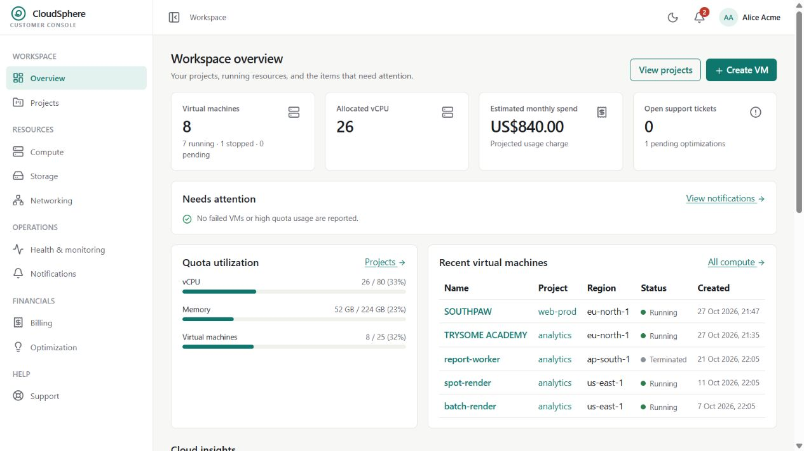
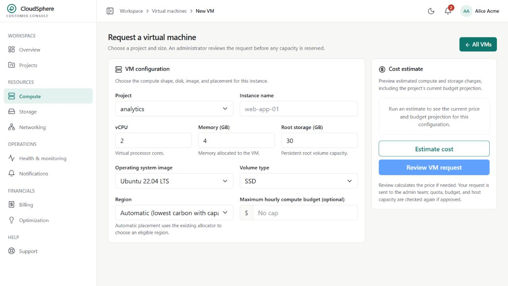
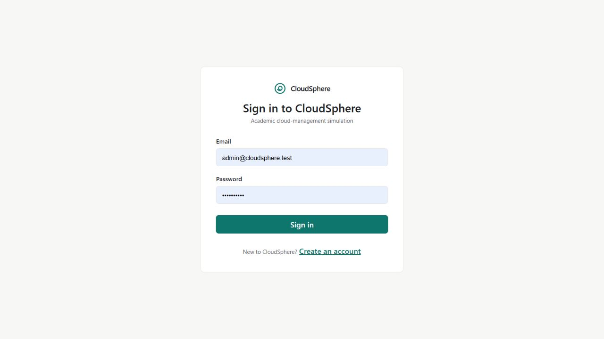
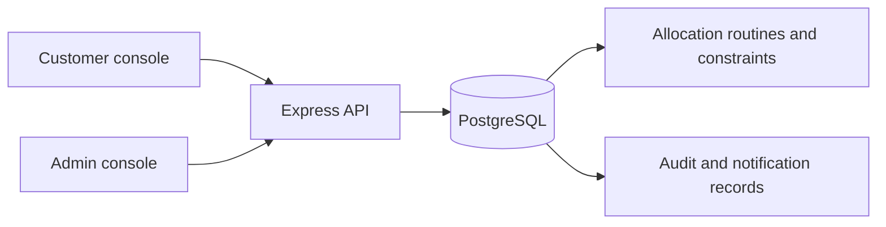

# CloudSphere

**A database-driven cloud infrastructure management simulator.**

CloudSphere lets customers organize projects, request virtual machines, and track resource usage. Administrators review requests and manage capacity and quotas. PostgreSQL enforces the allocation rules and records lifecycle changes.

> Academic simulation: VM records represent simulated infrastructure. The application does not boot real virtual machines or process real payments.

## Screenshots

Captured from the running local application using a demonstration account. Resource counts and dates reflect the demo database at capture time.

### Workspace overview

View VM status, allocated resources, estimated spend, and quota utilization.



### Request a virtual machine

Choose a project, CPU, RAM, storage, operating system, and region before requesting administrator approval.



### Sign in

Customer and administrator accounts use the same sign-in screen and enter their respective consoles.



## Features

- Customer and administrator sign-in with separate consoles.
- Organizations, projects, subscription plans, regions, and VM configurations.
- VM requests with administrator approval or rejection and in-app notifications.
- Cost estimates before requesting a VM.
- Allocation checks for project and organization quotas, budget, and host capacity.
- VM start, stop, and termination through database routines.
- Admin host capacity management, quota editing, and audit history.
- Views for storage, networking, monitoring, and billing records; these represent simulated data, not connected cloud services.
- Support ticket submission and notification read/unread management.

## How VM approval works

1. A customer selects a project and VM configuration and submits a request.
2. The request is stored as `PENDING`; it reserves no host capacity.
3. An administrator approves or rejects it.
4. Approval calls allocation routines that validate resource limits and reserve capacity, then links the request to its VM record.
5. The requester receives an in-app notification. Rejected requests retain the decision reason.

A stopped VM retains its CPU/RAM reservation. Termination releases reserved resources. The simulated provisioning step updates database state; it does not call a hypervisor.

## Architecture



| Layer | Technologies |
| --- | --- |
| Frontend | React, TypeScript, Vite, Bootstrap, TanStack Query, Axios, Recharts |
| Backend | Node.js, Express, pg, Zod |
| Database | PostgreSQL, PL/pgSQL, numbered SQL migrations |
| Database inspection | pgAdmin or psql |

## Repository layout

```text
frontend/             React application and styles
backend/src/          API routes, authentication, configuration, database access
backend/tests/        Database and API test suites
database/migrations/ Schema, constraints, routines, triggers, privileges
database/seeds/      Development demonstration data
database/scripts/    Bootstrap, migration, and seed tools
docs/                Schema notes and database demonstration guide
api/                 Vercel API entry point
vercel.json          Deployment build and routing configuration
```

## Run locally

### Prerequisites

Install Node.js 24 or later, npm, and PostgreSQL 15 or later. This project has been used locally with PostgreSQL 18. Ensure PostgreSQL is running. Commands below assume a terminal opened in the repository root.

### 1. Install dependencies

```sh
npm --prefix backend ci
npm --prefix frontend ci
```

### 2. Create the database and roles

For a **fresh installation**, run the bootstrap script using psql as a PostgreSQL administrator. Choose your own passwords:

```sh
psql -U postgres -d postgres -v migrator_pw="'YOUR_MIGRATOR_PASSWORD'" -v app_pw="'YOUR_APP_PASSWORD'" -f database/scripts/00_bootstrap.sql
```

This creates `cloudsphere`, its schema owner `cloudsphere_migrator`, and the application login `cloudsphere_app`. Run this once; skip it if those objects already exist. The script contains psql commands, so run it with psql rather than pasting it unchanged into pgAdmin Query Tool.

### 3. Configure the environment

Copy `backend/.env.example` to `backend/.env`, and `frontend/.env.example` to `frontend/.env`. In PowerShell:

```powershell
Copy-Item backend/.env.example backend/.env
Copy-Item frontend/.env.example frontend/.env
```

Set these backend values:

| Variable | Purpose |
| --- | --- |
| `DATABASE_URL` | Connection using `cloudsphere_app` |
| `MIGRATOR_DATABASE_URL` | Connection using `cloudsphere_migrator` |
| `JWT_SECRET` | Random secret of at least 32 characters |
| `CORS_ORIGIN` | Frontend origin; local default `http://localhost:5173` |
| `PORT` | API port; default `4000` |
| `COOKIE_SECURE` | `false` for local HTTP; `true` for HTTPS |

Generate a random secret with:

```sh
node -e "console.log(require('node:crypto').randomBytes(32).toString('hex'))"
```

Set frontend `VITE_API_BASE_URL=http://localhost:4000/api/v1`. VITE variables are visible to browsers: never put database credentials in them. URL-encode special characters in database URL passwords.

### 4. Apply migrations and load demo data

```sh
cd backend
npm run migrate
npm run seed
npm run dev
```

Migrations run in filename order and record checksums. Do not edit migrations already applied to a database; add a new migration instead. Seed data is intended for development.

### 5. Start the frontend

In a second terminal, from the repository root:

```sh
cd frontend
npm run dev
```

Open **http://localhost:5173**. The API runs on **http://localhost:4000**. These are the standard repository ports; a locally configured sharing server may use a different port.

## Demo accounts

After seeding, use these development accounts with password `Demo@12345`:

| Role | Email |
| --- | --- |
| Customer | `alice@acme.test` |
| Administrator | `admin@cloudsphere.test` |

These credentials are public demo data. Replace or remove demonstration accounts before exposing an installation with real data.

## Database design

There are 27 application tables, plus migration tracking and monitoring partitions. Core relationships include:

- Organizations own projects and reference subscription plans.
- Projects contain VM requests, VMs, storage, and networks.
- VM requests reference their requester and, after approval, their resulting VM.
- VMs reference configurations and assigned hosts; hosts belong to regions.
- Quotas represent organization or project limits and reserved usage.

Primary and foreign keys enforce relationships. CHECK constraints validate states and resource limits. Allocation routines use transactions and row locks. Triggers enforce VM transitions and record state changes. Generated host columns calculate free capacity from total minus allocated resources. Monitoring history is partitioned by time.

See [schema design](docs/phase1-schema-design.md) and the [database demo guide](docs/DATABASE_DEMO_GUIDE.md).

## Useful API routes

All application routes use `/api/v1`.

| Route | Purpose |
| --- | --- |
| `POST /auth/login` | Sign in |
| `GET /projects` | List accessible projects |
| `POST /vms/estimate` | Estimate VM costs |
| `POST /vm-requests` | Submit an approval request |
| `GET /admin/vm-requests` | Administrator request queue |
| `POST /admin/vm-requests/:id/decision` | Approve or reject |
| `GET /vms` | List accessible VMs |
| `GET /ready` | Database readiness |

Sessions use HTTP-only cookies. Mutating requests require the CSRF token and `X-Requested-With: CloudSphere`. Responses use `{ "data": ... }` or `{ "error": { "code", "message" } }`.

## Build and tests

```sh
npm --prefix frontend run build
```

Backend tests use a **separate disposable database** whose name ends in `_test`. Configure both test connection variables from `backend/.env.example`, bootstrap with `database/scripts/01_bootstrap_test_db.sql`, then run:

```sh
cd backend
npm run migrate:test
npm test
```

The test helpers clear test data between suites. Test files cover allocation, lifecycle, concurrency, privileges, partitions, seed data, and API behavior. Their presence is not a claim that every suite passes on every environment.

## Deployment and limitations

The repository includes Vercel build/routing configuration. A deployment needs a reachable hosted PostgreSQL database, server environment variables, migrations, and an appropriate frontend API base URL. A PostgreSQL service on your laptop is not reachable as `localhost` from a hosted deployment.

Real VM provisioning, real payments, a durable background worker, bulk monitoring ingestion, and production performance benchmarking are not implemented. Monitoring/billing records should be presented as simulation data. Review the actual routes before assuming a catalog or record view supports a complete provisioning workflow.

## Troubleshooting

- **Connection refused:** start the frontend/API and check the configured port.
- **Database not ready:** check PostgreSQL, database URLs, credentials, and migrations.
- **Missing environment variable:** run backend commands from `backend/` with its `.env` present.
- **Login or CSRF failure:** check the API URL, frontend origin, and cookie HTTPS setting.
- **No matching SQL rows:** inspect current data and filters; an empty result can be valid.

Local credentials, dependencies, build output, and logs are excluded by `.gitignore`.
