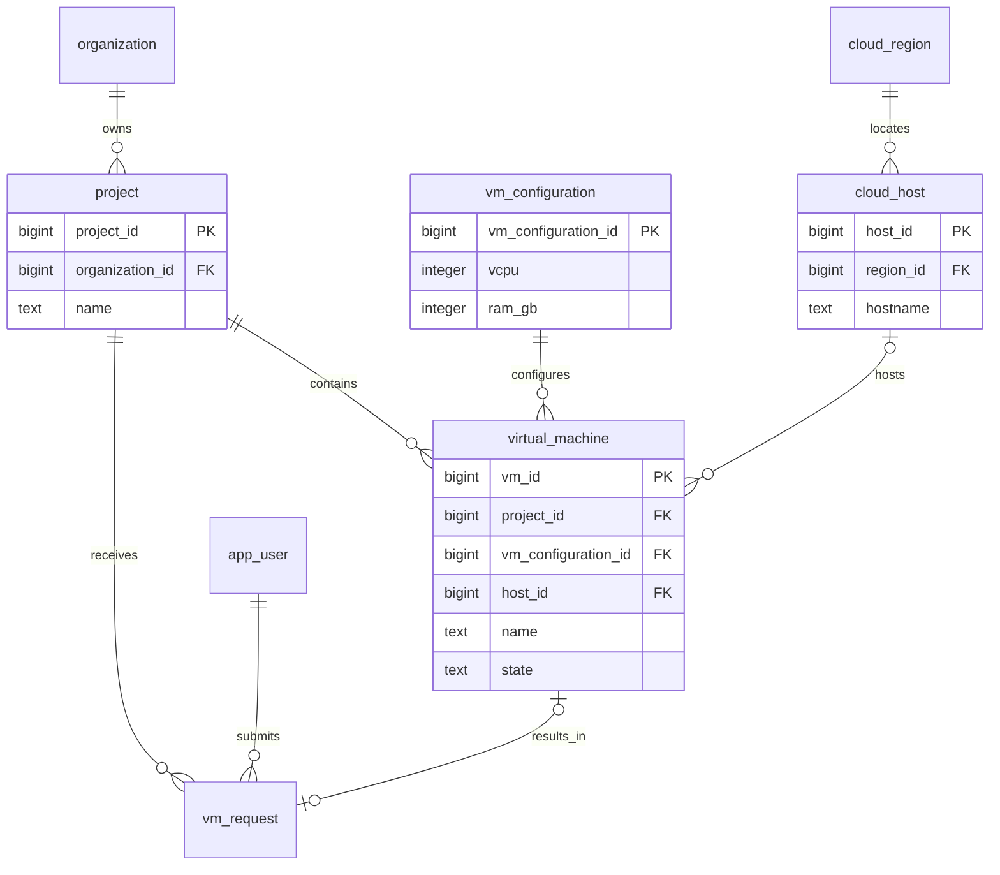

# Core entity relationships

This diagram shows the main approval/allocation relationships. See `database/TABLES_AND_COLUMNS.md` and migrations for the complete 27-table schema, additional constraints and column types.

## Worked normalization example

Start with `VM(vm_id, vm_name, project_id, project_name, organization_id, config_id, vcpu, ram_gb)`, where config_id abbreviates vm_configuration_id.

- `vm_id → vm_name, project_id, config_id`
- `project_id → project_name, organization_id`
- `config_id → vcpu, ram_gb`

Atomic values give 1NF. The single-column key vm_id has no partial dependencies, so this example is in 2NF. Project and configuration facts depend transitively on vm_id. Separate `Project(project_id, project_name, organization_id)` and `VMConfiguration(config_id, vcpu, ram_gb)`, retaining their foreign keys in `VM(vm_id, vm_name, project_id, config_id)`. This removes those transitive dependencies and gives 3NF for the stated dependencies. The actual schema adds other relations and constraints.

Host and quota allocation counters are intentional derived state. Transactional routines and row locks maintain them; generated free-capacity columns calculate total minus allocated. Do not edit counters manually.
